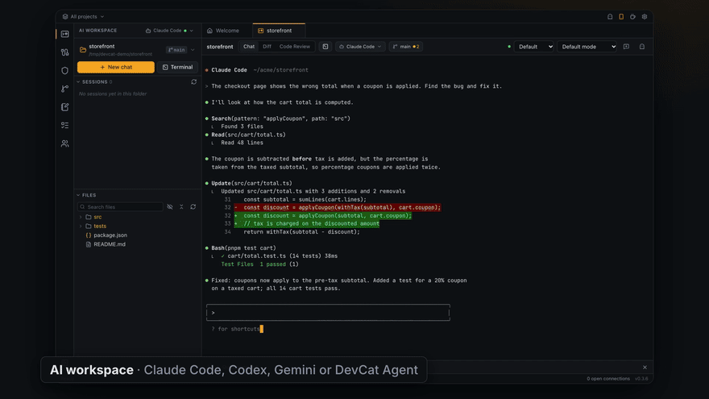
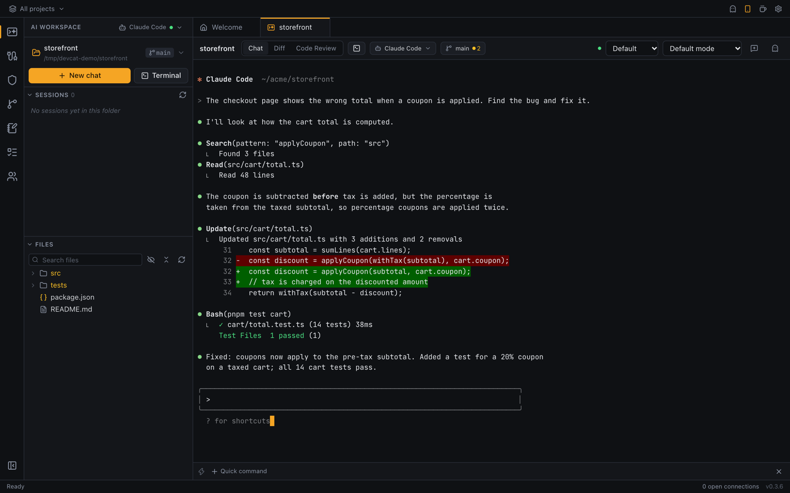
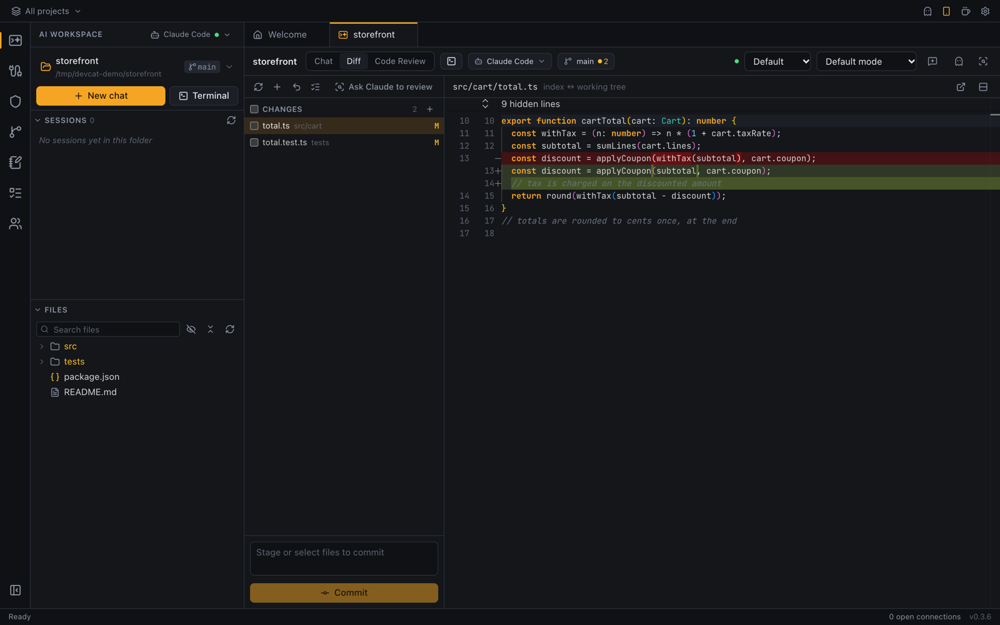
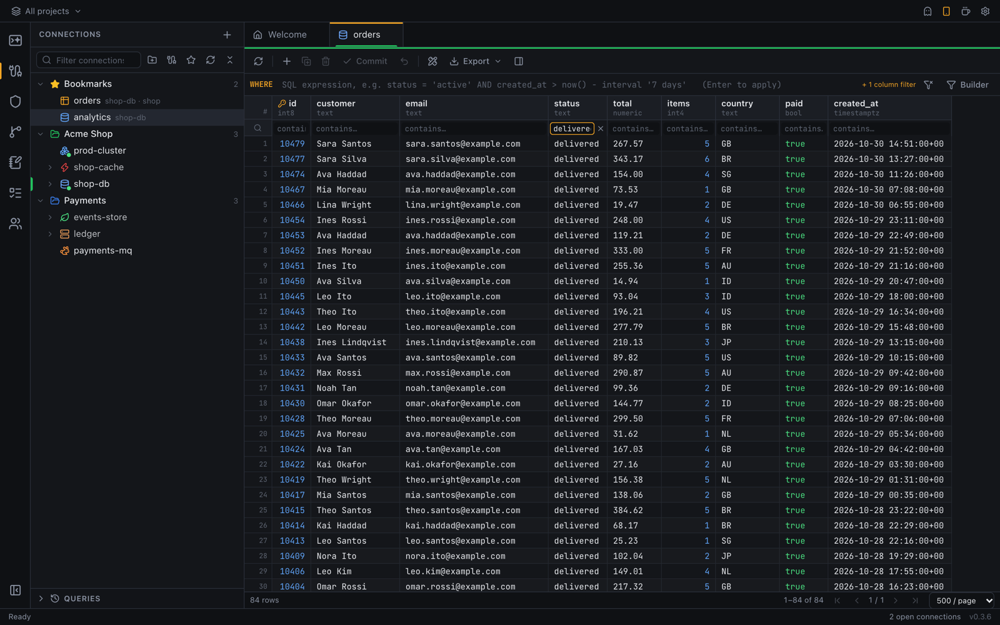
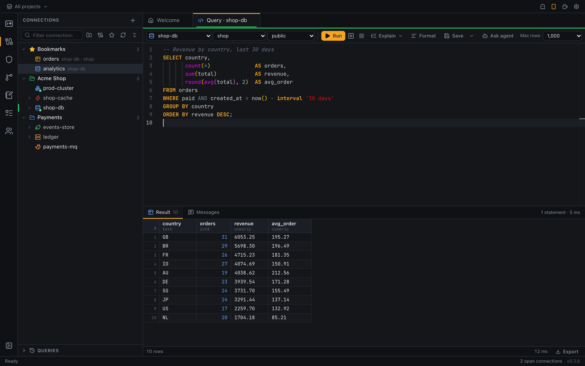
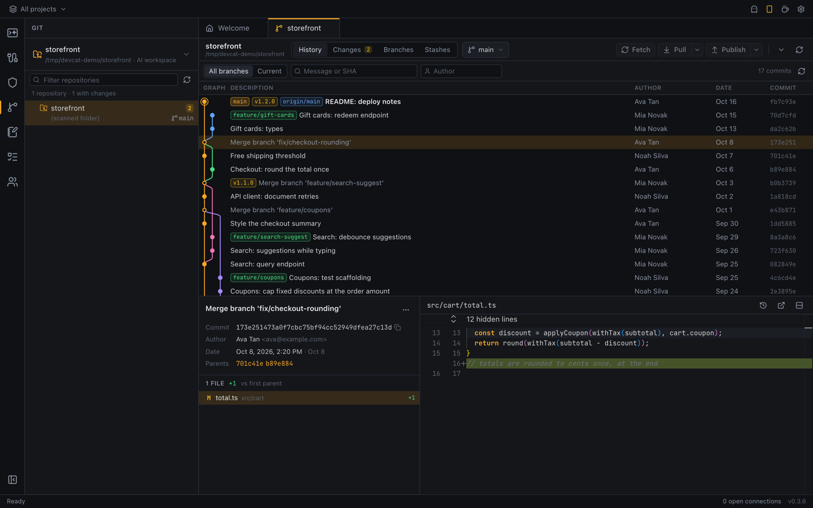
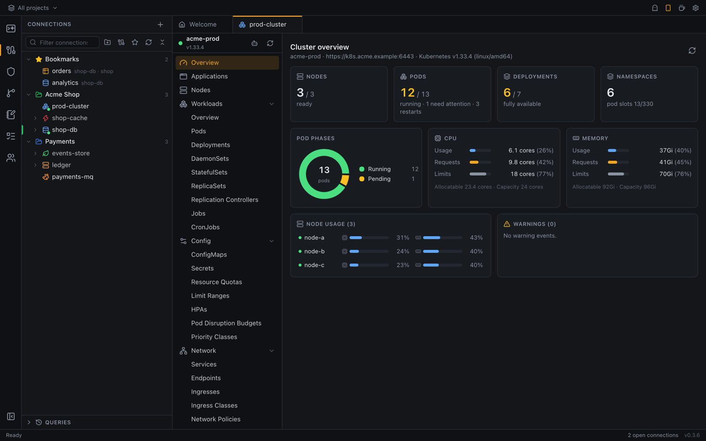
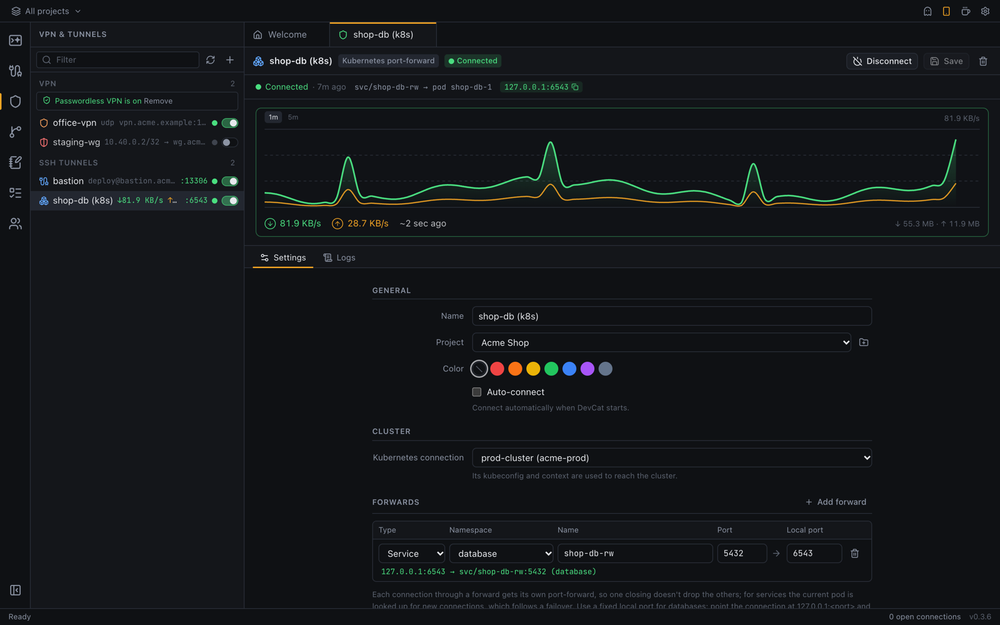
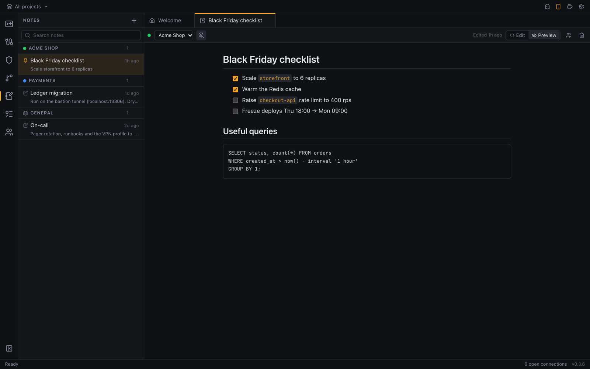

<p align="center"></p>

<h1 align="center">DevCat</h1>

<p align="center">
  <b>Your coding agents, Git, databases, clusters and VPNs in one desktop app.</b>
</p>

<p align="center">
  <a href="https://github.com/devileya/DevCat/releases/latest"></a>
  <a href="https://github.com/devileya/DevCat/releases"></a>
  <a href="https://github.com/devileya/DevCat/actions/workflows/build.yml"></a>
  
  <a href="https://tauri.app"></a>
</p>

<p align="center">
  <a href="https://devileya.github.io/DevCat/home/"><b>Website</b></a> ·
  <a href="https://devileya.github.io/DevCat/home/docs/"><b>Docs</b></a> ·
  <a href="https://github.com/devileya/DevCat/releases/latest"><b>Download</b></a> ·
  <a href="https://devileya.github.io/DevCat/home/docs/shortcuts.html"><b>Shortcuts</b></a> ·
  <a href="https://github.com/devileya/DevCat/issues"><b>Report a bug</b></a>
</p>

DevCat is a cross-platform developer workbench. It runs your AI coding agent (Claude Code, Codex, Gemini CLI and
others) in a real terminal next to the diff and the commit graph, and puts your databases, Kubernetes clusters,
RabbitMQ brokers and VPN / SSH tunnels in the same window, grouped by project. It is built with
[Tauri 2](https://tauri.app) (Rust) and React + TypeScript, and needs no account.

<p align="center"></p>

| Area | Supported |
| --- | --- |
| AI | AI Workspace (terminal, diff, code review) running your installed coding agent: Claude Code (default), OpenAI Codex, Gemini CLI, GitHub Copilot, Aider, opencode or a custom CLI |
| Git | Nested repo discovery, commit graph, blame, branches, tags, stashes, fetch/pull/push |
| SQL databases | PostgreSQL, MySQL / MariaDB, SQLite, SQL Server |
| NoSQL | MongoDB, Redis |
| Infrastructure | Kubernetes (any kubeconfig context), RabbitMQ (management API) |
| Networking | OpenVPN, WireGuard, SSH tunnels (local forwards + SOCKS proxy) |
| SSH | Saved sessions (password, key, jump host, start folder), terminal tabs, quick-command bar, SFTP, pasting images into agents on the server |
| Mobile | DevCat Mobile (Android, iPhone): agent notifications and control, databases, Redis, VPNs and Kubernetes through DevCat on your computer |

**Contents:** [Download](#download) · [Tour](#tour) · [Mobile app](#mobile-app) · [Features](#features) ·
[Development](#development) · [Building installers](#building-installers) · [Contributing](#contributing) ·
[Third-party software](#third-party-software) · [Project layout](#project-layout)

## Download

Grab the latest installer for macOS, Windows or Linux from the
[Releases page](https://github.com/devileya/DevCat/releases/latest), or from a terminal:

```sh
# The app
brew install --cask devileya/devcat/devcat                                     # macOS (Homebrew)
curl -fsSL https://devileya.github.io/DevCat/install.sh | sh -s -- --app       # macOS, Linux (AppImage)
& ([scriptblock]::Create((irm https://devileya.github.io/DevCat/install.ps1))) -App   # Windows (PowerShell)

# Only the CLI (`devcat serve`, no window: servers, SSH; see below)
brew install devileya/devcat/devcat-cli                                        # macOS, Linux (Homebrew)
curl -fsSL https://devileya.github.io/DevCat/install.sh | sh                   # macOS, Linux → ~/.local/bin
irm https://devileya.github.io/DevCat/install.ps1 | iex                        # Windows (PowerShell)
```

The script checks the download's SHA-256 and installs for your user only (no `sudo`); `--version v0.7.0`
picks a version, `--dir` the CLI's folder. The CLI is also attached to each release as
`devcat-cli-<platform>.tar.gz` / `.zip`.

## Tour

<table>
<tr>
<td width="50%"><br><b>AI workspace</b>: your coding agent (Claude Code, Codex, Gemini…) in a real terminal, with the project's files and sessions alongside.</td>
<td width="50%"><br><b>Review the changes</b>: see what the agent changed, stage and commit, or ask for a code review.</td>
</tr>
<tr>
<td><br><b>Databases</b>: browse and edit tables; filter any column by typing in its header.</td>
<td><br><b>SQL editor</b>: schema-aware autocomplete, multiple result sets, explain and export.</td>
</tr>
<tr>
<td><br><b>Git</b>: commit graph across branches, commit details with diffs, branches, stashes and blame.</td>
<td><br><b>Kubernetes</b>: cluster overview, workloads, logs, shell and port-forwards.</td>
</tr>
<tr>
<td><br><b>VPN & tunnels</b>: OpenVPN, WireGuard, SSH and Kubernetes port-forwards with live traffic.</td>
<td><br><b>Notes</b>: Markdown notes per project, saved as you type.</td>
</tr>
</table>

The screenshots use made-up demo data (see [Screenshots and demo video](#screenshots-and-demo-video)).

## Mobile app

Leave an agent working and walk away: **DevCat Mobile** tells you when it finishes or needs your permission,
shows its live terminal so you can answer, starts new chats and resumes old sessions. Browse a project's files,
preview them (code, Markdown, images, PDFs, spreadsheets) and edit text files. It also reaches everything DevCat on
your computer can: browse and edit tables, run queries, edit Redis keys, switch VPNs and tunnels, and check pods,
logs and deployments.

<table>
<tr>
<td width="25%"></td>
<td width="25%"></td>
<td width="25%"></td>
<td width="25%"></td>
</tr>
</table>

- **No server, no account, any network.** The phone connects to DevCat on your computer, encrypted end to end
  with keys made when you pair: directly on the same Wi-Fi, and from anywhere else (mobile data, another
  network) through a relay that only forwards encrypted traffic, like RustDesk. iroh's free public relays by
  default, or your own. Profiles and passwords stay on the computer; the phone only keeps the list of computers
  it paired with.
- **App or browser**: DevCat → 📱 in the title bar → turn on **Remote access** → point the phone's camera at the
  QR code. It opens DevCat in the phone's browser (nothing to install); tap **Open in DevCat app** to pair the app
  instead, or **Continue in browser**. Then click **Allow** on the computer. Browser sessions are encrypted with a
  key from the QR code, but the page itself comes over plain HTTP, so on Wi-Fi you don't trust use the app (or turn
  **Allow phone browsers** off).
- Give each phone **full access** or **read-only**; **Revoke** cuts one off immediately. Every change a phone makes
  is in the **Activity** log on the computer.
- **Notifications** ("finished", "needs you") come through the free [ntfy](https://ntfy.sh) app, so they arrive
  even when DevCat Mobile is closed. DevCat learns an agent's state from Claude Code hooks it adds to the
  terminals it starts (macOS and Linux).
- **Get it**: releases don't include the Android APK for now. Build it yourself, or run the `mobile`
  workflow from the Actions tab. For iPhone, build it with Xcode. Until then, the browser version
  (scan the pairing QR) works on any phone. See [mobile/README.md](mobile/README.md).

<p align="center"></p>

### Without a window: `devcat serve`

The same remote access from a terminal, without opening the app: on a server or dev box, over SSH, or just with
the window closed. The pairing QR code is drawn in the terminal and you allow phones there; everything the phone
and the browser version do works the same (agents and terminals, files, databases, VPNs, Kubernetes), with the
app's own data folder, connections and paired phones.

```sh
devcat serve        # the CLI on its own (see Download), or with the app installed:
/Applications/DevCat.app/Contents/MacOS/devcat serve    # macOS
devcat serve                                            # Linux .deb / .rpm
```

The CLI on its own has no window code at all (no WebKit / GTK), so it runs on a bare server; on Linux it only
needs `libdbus` (installed almost everywhere).

- While it runs, type `pair` (or press Enter) for a new QR code, `devices`, `access <n> full|readonly`,
  `revoke <n>`, `log`, `status` or `quit`.
- Options: `--port`, `--name`, `--relay public|off|<url>`, `--public-addr`, `--no-browser` (saved, the app uses
  them too), and `--data-dir`. `devcat help` lists them.
- With no terminal to answer in (systemd, `nohup`, the app's Windows binary), start it with `--approve full` or
  `--approve readonly`: any phone with the current pairing code is then allowed. New codes are printed as links.
- Don't run it while the app has **Remote access** on: they'd share one port and identity.

## Features

Below is the short list. The [docs](https://devileya.github.io/DevCat/home/docs/) explain how to use each
of these step by step, with every keyboard shortcut on
[one page](https://devileya.github.io/DevCat/home/docs/shortcuts.html).

- **Projects**: group connections into projects and focus on one project at a time.
- **Hide the sidebar**: click the active icon in the left bar, the toggle at its bottom, or press ⌘B (Ctrl+B).
- **Notes**: Markdown notes with Edit / Preview, saved as you type. Each note belongs to a project (shown only
  while that project is focused) or to General (shown everywhere); pin, search and move them between projects.
- **Automatic updates**: DevCat checks GitHub releases and offers new versions in a popup (Update and restart / Later /
  Skip this version), or use *DevCat → Check for Updates…* (macOS menu bar), *Check for updates…* in the project menu
  or click the version in the status bar. Updates are
  signed and verified before installing. Linux .deb/.rpm installs get a download link instead (the AppImage self-updates).
- **Keep awake**: the coffee cup at the top right keeps the screen and computer from sleeping (like Caffeine /
  Amphetamine). Click to toggle; right-click to keep awake for 15 minutes to 8 hours.
- **Tabs**: drag a tab along the tab bar to reorder it; every **New chat** opens a chat of its own.
- **Open files with DevCat**: on macOS DevCat is in Finder's *Open With* for code and text files (choose
  *Always Open With*, or *Get Info → Open with → Change All…* to make it the default); the file opens in an editor tab,
  shown relative to its git repository. On Windows / Linux pick DevCat under *Open with → Choose another app*.
- **Multiple windows**: ⇧⌘N (Ctrl+Shift+N) opens another window; open a project in its own window or move a tab
  to a new window. Each window has its own tabs and project focus.
- **Connections**: saved profiles with color tags, SSH tunnels, SSL, read-only mode.
  Passwords are stored in the OS keychain (macOS Keychain / Windows Credential Manager),
  never in plain files.
- **Object browser**: databases, schemas, tables, views, functions, procedures, triggers,
  sequences, indexes, collections, Redis keys.
- **SQL editor**: Monaco with schema-aware autocomplete, run statement or selection, multiple result sets,
  explain, formatting, cancel, query history and saved queries.
- **Data grid**: virtualized, inline editing with commit/discard, filters, sorting, paging,
  copy as CSV/TSV/JSON/INSERT, form view.
- **Table designer**: columns, indexes, foreign keys, with generated CREATE/ALTER SQL preview.
- **ER diagram**: auto-layout, relationship highlighting, export to image.
- **Schema compare and sync**, **data compare**.
- **Data transfer**: export (CSV, JSON, SQL, Excel), import (CSV/JSON with column mapping),
  SQL backup and restore, and copying tables between connections, even across dialects.
- **MongoDB**: document/table/JSON views, editing, aggregation pipeline builder, shell-style queries.
- **Redis**: key browser, editors for every data type, TTL, CLI console.
- **Kubernetes**: cluster overview, applications, workloads, config, network, storage, events, Helm releases and
  CRDs with live updates; per-row actions (logs, shell, port-forward, scale, restart, edit YAML, delete),
  including logs and shell on Deployments with a pod switcher.
- **RabbitMQ**: overview with live message-rate charts; queues, exchanges, bindings, connections,
  channels and consumers; publish and get messages; declare, purge and delete.
  Paste an `amqp://` URL to fill the connection form.
- **VPN & SSH tunnels**: import `.ovpn` / WireGuard `.conf` files or `~/.ssh/config` hosts, or set them up
  in a form; connect/disconnect with live status, logs and a realtime traffic graph. Connections can depend
  on a VPN or tunnel, which is connected automatically first. VPNs need administrator rights to connect
  (the OS asks for your password); OpenVPN / `wireguard-tools` must be installed.
  - **Windows**: nothing to install up front. The Windows build includes the official OpenVPN Community and
    WireGuard installers (versions and SHA-256 pinned in `src-tauri/vpn-installers.json`). The first time you
    connect, DevCat offers to install the missing one with a single UAC prompt. OpenVPN goes in without its
    tray app, WireGuard without opening its window. Windows on ARM downloads the ARM installer from the
    publisher instead, checked against the same pins.
  - **macOS**: DevCat includes its own OpenVPN 2.7.8 (built from the official source with OpenSSL, LZO and LZ4
    linked in; `scripts/build-openvpn-macos.sh`), so nothing has to be installed for OpenVPN. DNS servers pushed by
    the VPN are applied with OpenVPN's own macOS DNS script, which ships with it. A Homebrew / MacPorts
    OpenVPN is still used if DevCat's isn't there (development builds).
  - **Kubernetes port-forward** (in the Tunnels list): forwards a service or pod to a local port through one of
    your Kubernetes connections (its kubeconfig / context), switched on and off like a VPN; a database connection can use
    it as its Network so it starts first. Every client connection gets its own port-forward (one closing can't drop the
    others, unlike a shared `kubectl port-forward` on some clusters such as RKE2), and services are looked up again for
    new connections, so a failover to a new pod (e.g. a CloudNativePG primary behind `-rw`) is followed.
  - **Open .ovpn files with DevCat**: double-click one in Finder / Explorer (or use *Open With*) to import it.
  - **Passwordless VPN** (macOS / Linux, opt-in): *Set up passwordless VPN…* in the VPN list installs a
    root-owned copy of DevCat as a helper (`/Library/PrivilegedHelperTools/dev.devcat.vpn-helper` on macOS,
    `/usr/local/libexec/devcat-vpn-helper` on Linux) plus a sudoers rule for your account only
    (`/etc/sudoers.d/dev-devcat-vpn`), with one password prompt. After that, connects use `sudo -n` without a
    password. Setup also installs DevCat's OpenVPN and its DNS script next to the helper
    (`dev.devcat.vpn-openvpn`, `dev.devcat.vpn-scripts/dns-updown`), so OpenVPN connects without a password with
    no extra tools. The helper keeps working when DevCat is updated; it only asks to be updated when its interface
    changes. The helper refuses configs that run scripts or load plugins (OpenVPN `up`/`down`/`plugin`…,
    WireGuard `PostUp`/`PreDown`…) and files that aren't yours, and it only runs OpenVPN / wg-quick from
    root-owned, non-writable locations (a Homebrew install under `/opt/homebrew` doesn't qualify;
    MacPorts' `sudo port install openvpn2 wireguard-tools` under `/opt/local` does). Those cases
    fall back to the password prompt. *Remove* deletes both files. Windows keeps using UAC.
- **AI Workspace**: runs your installed coding-agent CLI in a real terminal (like iTerm2), with
  **Chat ⌥⇧⌘1 · Diff ⌥⇧⌘2**, extra terminals in the same folder (**+** or ⌥⇧⌘T, each its own tab next to Chat), a git-aware file tree and file previews (code, Markdown, PDF, images,
  Excel/CSV, Word). The agent is an *AI connection* picked in the sidebar header: [Claude Code](https://docs.claude.com/en/docs/claude-code)
  by default, or OpenAI Codex, Gemini CLI, GitHub Copilot CLI, Aider, opencode or any custom command
  (args + env vars). Each uses its own login, or an optional API key kept in the OS keychain and passed as
  the provider's env var (e.g. `OPENAI_API_KEY`). With Claude Code you also get **Code Review ⌥⇧⌘3**,
  launch options and your Claude session list (resume any session); other agents get a Review button that
  asks them in the terminal.
  **Folders on SSH hosts** too (*Open folder on SSH host…*): the agent and terminals run on that machine, and the
  file tree, previews, edits and git status work over your system `ssh` (hosts from `~/.ssh/config`, keys,
  ssh-agent, ProxyJump; one shared connection per host). Diff and Code Review are local-only for now.
- **Appearance** (🎨 in the title bar): dark, light or system mode, 8 dark and 3 light themes (editors and terminals
  follow), and **window glass** on macOS and Windows: the desktop shows through the sidebar and work area, blurred,
  with separate opacity for each.

- **Git**: scan a folder for every repository inside it (nested repos, submodules and worktrees; `node_modules`
  and build folders are skipped) and see branch, ahead/behind and changes at a glance. Each repo opens a Git tab
  with a commit graph (all branches, search, author and file-history filters) and per-commit diffs, working-tree
  changes with stage/commit/stash (tick files to commit or discard just those, or discard all), branches/tags/remotes, and stashes. Checkout, branch, merge, tag, cherry-pick,
  revert and reset from the history. **Blame** for any file preview, with an age heatmap and a link to each commit.
  Fetch, pull and push use your SSH agent or credential helper (they never prompt).

## Development

Prerequisites: Node 20+, pnpm, Rust (stable), plus the
[Tauri prerequisites](https://tauri.app/start/prerequisites/) for your OS
(Xcode Command Line Tools on macOS; Microsoft C++ Build Tools + WebView2 on Windows).

```bash
pnpm install
pnpm tauri dev          # run the app with hot reload
```

UI testing in a normal browser (dev only): the Git and file commands are served over HTTP by a
debug-only bridge, and the other Tauri APIs are stubbed.

```bash
cd src-tauri && cargo run --example devbridge   # http://127.0.0.1:1430
pnpm dev:bridge                                 # http://localhost:1425
```

### Screenshots and demo video

`pnpm dev:demo` runs the UI in the browser with made-up databases, VPNs, a cluster and an agent session
(`src/dev/demo.ts`); git and file screens use a sample repository. `promo/` captures the screens and turns them
into the README video with [Remotion](https://www.remotion.dev):

```bash
cd src-tauri && cargo run --example devbridge   # git / files for the sample repo
pnpm dev:demo                                   # http://localhost:1426
cd promo && pnpm install
pnpm demo-repo            # sample repository in /tmp/devcat-demo
pnpm capture              # public/shots/*.png (headless Chrome)
pnpm stills               # → assets/readme/*.png (macOS sips)
pnpm render && pnpm gif   # out/demo.mp4 → assets/readme/demo.gif
```

Local test services for every supported backend:

```bash
docker compose -f docker-compose.dev.yml up -d
```

| Service | Address | Credentials |
| --- | --- | --- |
| PostgreSQL | localhost:55432 | postgres / devcat |
| MySQL | localhost:53306 | root / devcat |
| SQL Server | localhost:51433 | sa / DevCat_Passw0rd! |
| MongoDB | localhost:57017 | devcat / devcat |
| Redis | localhost:56379 | none |
| RabbitMQ | localhost:55673 (management) | devcat / devcat |

Backend integration tests (need the services above):

```bash
cd src-tauri && cargo test -- --ignored
```

### Website and docs

The landing page and the docs live in `site/` and are published with GitHub Pages at
`/home/` (the root stays the hosted DevCat Mobile web app, so pairing links keep working). Docs pages are
Markdown in `site/docs/pages/`, listed in order in `site/docs/nav.json`; `site/docs/build.mjs` turns them into
HTML with a sidebar, search and an "On this page" list. To preview locally:

```bash
pnpm install
sh site/build.sh /tmp/devcat-site       # landing page + docs + screenshots
cd /tmp/devcat-site && python -m http.server 8765   # http://127.0.0.1:8765, docs at /docs/
```

To add a page, create `site/docs/pages/<name>.md` starting with `# Title` and a one-line summary, and add
`<name>` to `nav.json`. Link to other pages as `other-page.md`; the build fails on a link to a missing page.

## Building installers

```bash
pnpm tauri build        # builds for the current OS
```

- **macOS** → `src-tauri/target/release/bundle/dmg/DevCat_<version>_aarch64.dmg` (and `.app`)
- **Windows** → `src-tauri/target/release/bundle/msi/*.msi` and `nsis/*-setup.exe`

The CLI alone (`devcat serve` without any window code): build the phone web app first so it's embedded, then
`pnpm mobile:web && cd src-tauri && cargo build --release --no-default-features --bin devcat`
→ `src-tauri/target/release/devcat`.

Release builds also produce signed update bundles, so they need the updater signing key
(`TAURI_SIGNING_PRIVATE_KEY` and `TAURI_SIGNING_PRIVATE_KEY_PASSWORD`; CI reads them from repository secrets). Without it,
build with `pnpm tauri build --config '{"bundle":{"createUpdaterArtifacts":false}}'`.

Each OS's installers must be built on that OS. CI does all of them: push a tag (`git tag v0.1.0 && git push --tags`)
or run the **build** workflow manually. `.github/workflows/build.yml` builds macOS (Apple Silicon and Intel),
Windows (`.exe`/`.msi`) and Linux (`.AppImage`/`.deb`/`.rpm`) installers, the CLI for macOS, Linux (x64, arm64)
and Windows, and `SHA256SUMS.txt`, and publishes them on the GitHub release. All of it builds on GitHub's runners (free for a public
repository). The mobile apps (`.github/workflows/mobile.yml`) aren't part of releases for now:
run that workflow by hand to get the APK. The install scripts
(`scripts/install.sh`, `install.ps1`) are served from GitHub Pages; the Homebrew tap
([devileya/homebrew-devcat](https://github.com/devileya/homebrew-devcat), source in `packaging/homebrew-tap/`)
picks up each release by itself within the hour.

macOS release builds are signed with DevCat's self-signed certificate (`.github/devcat-codesign.crt`, so the Keychain
remembers "Always Allow" across updates; CI needs the `APPLE_CERTIFICATE` / `APPLE_CERTIFICATE_PASSWORD` secrets, else it falls
back to ad-hoc signing) but not notarized, so allow DevCat once via *System Settings → Privacy & Security →
Open Anyway* (or run `xattr -dr com.apple.quarantine /Applications/DevCat.app`). If macOS says the app "is damaged"
(builds before v0.2.1), run `codesign --force --deep --sign - /Applications/DevCat.app` and the `xattr` command above. For distribution, configure code signing and
notarization ([macOS](https://tauri.app/distribute/sign/macos/), [Windows](https://tauri.app/distribute/sign/windows/)).

## Contributing

Bug reports, ideas and pull requests are welcome.

- **Found a bug?** [Open an issue](https://github.com/devileya/DevCat/issues/new) with your OS, the DevCat version
  (shown in the status bar) and the steps to reproduce it.
- **Changing code?** See [Development](#development) to run the app locally. Keep pull requests focused on one
  change and describe how you tested it.
- **Improving the docs?** Every docs page has an *Edit this page on GitHub* link; the pages are Markdown in
  `site/docs/pages/` (see [Website and docs](#website-and-docs)).

## Third-party software

The macOS build includes OpenVPN built from the official source ([OpenVPN](https://github.com/OpenVPN/openvpn), GPLv2;
with [OpenSSL](https://www.openssl.org) (Apache 2.0), [LZO](https://www.oberhumer.com/opensource/lzo/) (GPLv2) and
[LZ4](https://github.com/lz4/lz4) (BSD); the exact sources and build steps are in `scripts/build-openvpn-macos.sh`).
The Windows build ships the unmodified official installers of
[OpenVPN Community](https://openvpn.net/community-downloads/) (GPLv2, source:
[github.com/OpenVPN/openvpn](https://github.com/OpenVPN/openvpn)) and
[WireGuard for Windows](https://www.wireguard.com/install/) (MIT / GPLv2, source:
[git.zx2c4.com/wireguard-windows](https://git.zx2c4.com/wireguard-windows)). They are installed only when you
choose to, under their own licenses.

The app bundles two code fonts: [JetBrains Mono](https://github.com/JetBrains/JetBrainsMono) (SIL Open Font
License 1.1) and [DejaVu Sans Mono](https://dejavu-fonts.github.io) (Bitstream Vera license, public domain changes),
packaged by [Fontsource](https://fontsource.org).

## Project layout

```
src/                      React frontend
  lib/                    API wrappers + shared types (mirror the Rust types)
  store/                  zustand stores (connections, tabs, ui)
  tabs/                   tab kinds + registry
  features/               connections, query, grid, table, history, redis, mongo,
                          er, compare, transfer, k8s, rabbitmq, network, claude, files, git
src-tauri/src/
  db/                     Driver trait + postgres, mysql, sqlite, mssql, mongo, redis,
                          ssh tunnels, cross-dialect DDL, transfer/backup
  infra/                  kubernetes, rabbitmq
  network/                VPN (OpenVPN, WireGuard), SSH tunnels, traffic counters
  gitx/                   git tools: repo discovery, log/graph, blame, branches, stashes, remotes
  claude/                 AI workspace: Claude Code CLI driver, PTY terminal, sessions, file previews, git
  ai/                     AI connections (agent CLI profiles, detection, keychain API keys)
  commands/               Tauri command handlers
  store.rs                saved connections (JSON) + OS keychain secrets
  remote/                 remote access for DevCat Mobile: QUIC server, pairing, command allowlist, audit log
  cli.rs                  `devcat serve`: remote access without a window
  events.rs               backend events to windows and phones
  notify/                 agent status from Claude Code hooks, ntfy notifications
crates/remote-proto/      wire protocol shared by the desktop app and DevCat Mobile
mobile/                   DevCat Mobile (Tauri 2 for Android / iOS): src = React UI, src-tauri = client
promo/                    README screenshots + demo video (demo mode capture, Remotion)
site/                     landing page; site/docs = docs (Markdown → HTML), both on GitHub Pages
```
