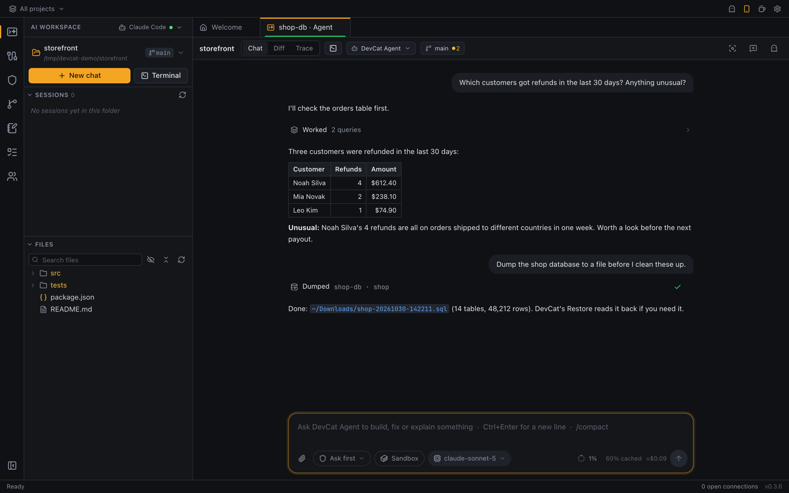
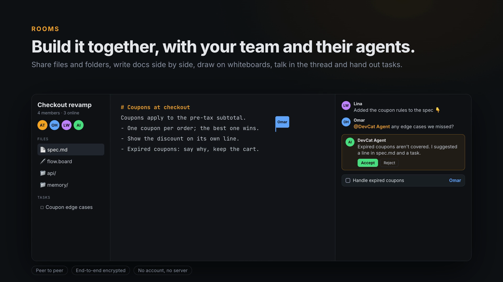
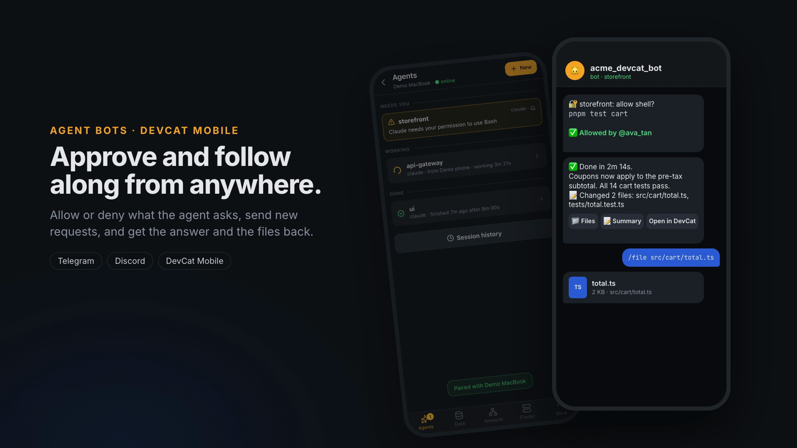
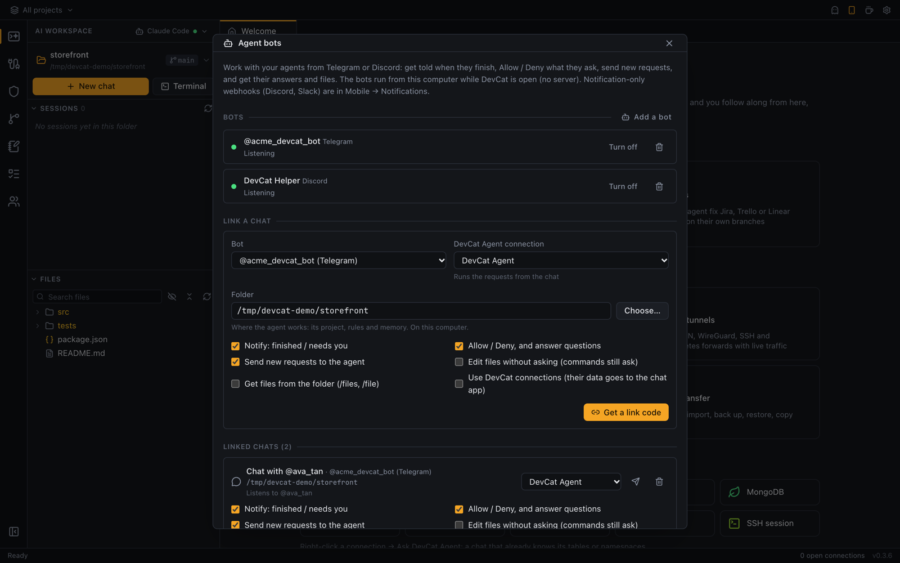
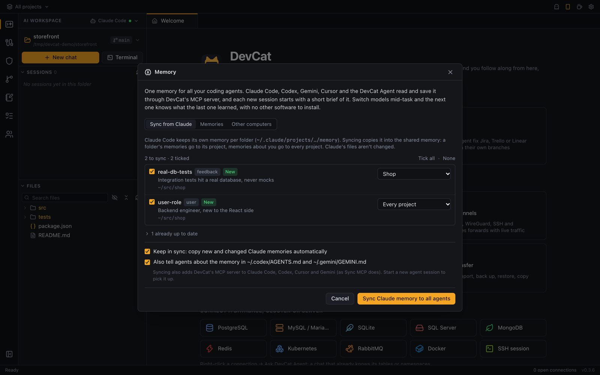
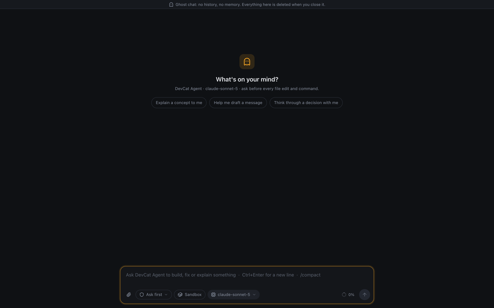

<p align="center"></p>

<h1 align="center">DevCat</h1>

<p align="center">
  <b>Your agents, repos, databases and clusters. One window.</b>
</p>

<p align="center">
  <a href="https://github.com/devcathq/DevCat/releases/latest"></a>
  <a href="https://github.com/devcathq/DevCat/releases"></a>
  <a href="https://github.com/devcathq/DevCat/actions/workflows/build.yml"></a>
  
  <a href="https://tauri.app"></a>
</p>

<p align="center">
  <a href="https://devcat.ai.id"><b>Website</b></a> ·
  <a href="https://devcat.ai.id/docs/"><b>Docs</b></a> ·
  <a href="https://github.com/devcathq/DevCat/releases/latest"><b>Download</b></a> ·
  <a href="https://devcat.ai.id/docs/shortcuts.html"><b>Shortcuts</b></a> ·
  <a href="https://github.com/devcathq/DevCat/issues"><b>Report a bug</b></a>
</p>

DevCat is a free, cross-platform workbench for coding with AI agents. Run the agent you already use (Claude Code,
Codex, Gemini CLI and others) in a real terminal, or the built-in **DevCat Agent**, its own agent harness that talks
to any model API. Review what it changed next to the diff and the commit graph, and let it work with your
databases, Kubernetes clusters, Docker, RabbitMQ and VPN / SSH tunnels, all in the same window and grouped by
project. Build with other people in **Rooms** (peer to peer, end-to-end encrypted), give every agent **one shared
memory**, and keep your agents going from **your phone** or a **Telegram / Discord chat**. Built with
[Tauri 2](https://tauri.app) (Rust) and React + TypeScript; no account, no server.

<p align="center"></p>

| Area | Supported |
| --- | --- |
| AI | AI Workspace (terminal, diff, code review) running your installed coding agent: Claude Code (default), OpenAI Codex, Gemini CLI, GitHub Copilot, Aider, opencode or a custom CLI; or the built-in DevCat Agent (its own harness: tools, approvals, hooks, MCP, sandbox, helpers) with any OpenAI- or Anthropic-compatible model. Ask the agent about any connection, or start a ghost chat that keeps nothing |
| Memory | One memory every agent shares (Claude Code, Codex, Cursor, Gemini, DevCat Agent), synced between your own computers |
| Rooms | Work with other people, peer to peer and end-to-end encrypted: files, docs, whiteboards, a thread, tasks, and everyone's agents |
| MCP | Sync MCP: DevCat's MCP server in Claude Code, Codex, Cursor and Gemini CLI, with off / read-only / full access per connection and an activity log |
| Tickets | Jira, Trello and Linear: the agent fixes tickets from a column on their own branches, comments on them and moves them on (e.g. to Testing); results to Slack |
| Git | Nested repo discovery, commit graph, blame, branches, tags, stashes, fetch/pull/push |
| SQL databases | PostgreSQL, MySQL / MariaDB, SQLite, SQL Server |
| NoSQL | MongoDB, Redis |
| Infrastructure | Kubernetes (any kubeconfig context), Docker (any context, or a host over SSH / TCP), RabbitMQ (management API) |
| Networking | OpenVPN, WireGuard, SSH tunnels (local forwards + SOCKS proxy) |
| SSH | Saved sessions (password, key, jump host, start folder), terminal tabs, quick-command bar, SFTP, port forwards, pasting images into agents on the server |
| Mobile & chat | DevCat Mobile (Android, iPhone): agent notifications and control, databases, Redis, VPNs and Kubernetes through DevCat on your computer. Agent bots in Telegram and Discord: approve, send requests, get results and files. Notifications to ntfy, Discord, Slack or any webhook |

**Contents:** [Download](#download) · [Tour](#tour) · [Mobile app](#mobile-app) · [Agent bots](#agent-bots) · [Features](#features) ·
[Development](#development) · [Building installers](#building-installers) · [Contributing](#contributing) ·
[Third-party software](#third-party-software) · [Project layout](#project-layout)

## Download

Grab the latest installer for macOS, Windows or Linux from the
[Releases page](https://github.com/devcathq/DevCat/releases/latest), or from a terminal:

```sh
# The app
brew install --cask devcathq/devcat/devcat                                     # macOS (Homebrew)
curl -fsSL https://devcathq.github.io/DevCat/install.sh | sh -s -- --app       # macOS, Linux (AppImage)
& ([scriptblock]::Create((irm https://devcathq.github.io/DevCat/install.ps1))) -App   # Windows (PowerShell)

# Only the CLI (`devcat serve`, no window: servers, SSH; see below)
brew install devcathq/devcat/devcat-cli                                        # macOS, Linux (Homebrew)
curl -fsSL https://devcathq.github.io/DevCat/install.sh | sh                   # macOS, Linux → ~/.local/bin
irm https://devcathq.github.io/DevCat/install.ps1 | iex                        # Windows (PowerShell)
```

The script checks the download's SHA-256 and installs for your user only (no `sudo`); `--version v0.7.0`
picks a version, `--dir` the CLI's folder. The CLI is also attached to each release as
`devcat-cli-<platform>.tar.gz` / `.zip`.

## Tour

<table>
<tr>
<td width="50%"><br><b>AI workspace</b>: your coding agent (Claude Code, Codex, Gemini…) in a real terminal, with the project's files and sessions alongside.</td>
<td width="50%"><br><b>Ask a connection</b>: right-click a database or cluster for a DevCat Agent chat that already knows its tables; it queries, dumps and exports.</td>
</tr>
<tr>
<td><br><b>Review the changes</b>: see what the agent changed, stage and commit, or ask for a code review.</td>
<td><br><b>Git</b>: commit graph across branches, commit details with diffs, branches, stashes and blame.</td>
</tr>
<tr>
<td><br><b>SQL editor</b>: schema-aware autocomplete, multiple result sets, explain and export.</td>
<td><br><b>Kubernetes</b>: cluster overview, workloads, logs, shell and port-forwards.</td>
</tr>
<tr>
<td><br><b>Rooms</b>: build with other people and their agents, peer to peer and end-to-end encrypted: files, docs, whiteboards, a thread and tasks.</td>
<td><br><b>From anywhere</b>: allow what the agent asks, send requests and get the results in Telegram, Discord or DevCat Mobile.</td>
</tr>
<tr>
<td><br><b>Agent bots</b>: link a Telegram or Discord chat to a project; approve, send requests and get results there.</td>
<td><br><b>One memory</b> for Claude Code, Codex, Cursor, Gemini and the DevCat Agent, across your computers.</td>
</tr>
<tr>
<td><br><b>Ghost chat</b>: a fresh DevCat Agent chat in its own window, with no project and nothing kept when you close it.</td>
<td><br><b>VPN & tunnels</b>: OpenVPN, WireGuard, SSH and Kubernetes port-forwards with live traffic.</td>
</tr>
</table>

The screenshots use made-up demo data (see [Screenshots and demo video](#screenshots-and-demo-video)).

## Mobile app

Leave an agent working and walk away: **DevCat Mobile** tells you when it finishes or needs your permission,
shows its live terminal so you can answer, starts new chats and resumes old sessions. Browse a project's files,
preview them (code, Markdown, images, PDFs, spreadsheets) and edit text files. It also reaches everything DevCat on
your computer can: browse and edit tables, run queries, edit Redis keys, switch VPNs and tunnels, and check pods,
logs and deployments.

<table>
<tr>
<td width="25%"></td>
<td width="25%"></td>
<td width="25%"></td>
<td width="25%"></td>
</tr>
</table>

- **No server, no account, any network.** The phone connects to DevCat on your computer, encrypted end to end
  with keys made when you pair: directly on the same Wi-Fi, and from anywhere else (mobile data, another
  network) through a relay that only forwards encrypted traffic, like RustDesk. iroh's free public relays by
  default, or your own. Profiles and passwords stay on the computer; the phone only keeps the list of computers
  it paired with.
- **App or browser**: DevCat → ⚙️ Settings → **Mobile pairing** → turn on **Remote access** → point the phone's camera at the
  QR code. It opens DevCat in the phone's browser (nothing to install); tap **Open in DevCat app** to pair the app
  instead, or **Continue in browser**. Then click **Allow** on the computer. Browser sessions are encrypted with a
  key from the QR code, but the page itself comes over plain HTTP, so on Wi-Fi you don't trust use the app (or turn
  **Allow phone browsers** off).
- Give each phone **full access** or **read-only**; **Revoke** cuts one off immediately. Every change a phone makes
  is in the **Activity** log on the computer.
- **Notifications** ("finished", "needs you") come through the free [ntfy](https://ntfy.sh) app, so they arrive
  even when DevCat Mobile is closed, and to Discord, Slack or any webhook as well (Mobile pairing →
  Notifications). DevCat Agent chats report their state themselves; Claude Code's comes from hooks DevCat adds to
  the terminals it starts (macOS and Linux).
- **Get it**: releases don't include the Android APK for now. Build it yourself, or run the `mobile`
  workflow from the Actions tab. For iPhone, build it with Xcode. Until then, the browser version
  (scan the pairing QR) works on any phone. See [mobile/README.md](mobile/README.md).

<p align="center"></p>

### Without a window: `devcat serve`

The same remote access from a terminal, without opening the app: on a server or dev box, over SSH, or just with
the window closed. The pairing QR code is drawn in the terminal and you allow phones there; everything the phone
and the browser version do works the same (agents and terminals, files, databases, VPNs, Kubernetes), with the
app's own data folder, connections and paired phones.

```sh
devcat serve        # the CLI on its own (see Download), or with the app installed:
/Applications/DevCat.app/Contents/MacOS/devcat serve    # macOS
devcat serve                                            # Linux .deb / .rpm
```

The CLI on its own has no window code at all (no WebKit / GTK), so it runs on a bare server; on Linux it only
needs `libdbus` (installed almost everywhere).

- While it runs, type `pair` (or press Enter) for a new QR code, `devices`, `access <n> full|readonly`,
  `revoke <n>`, `log`, `status` or `quit`.
- Options: `--port`, `--name`, `--relay public|off|<url>`, `--public-addr`, `--no-browser` (saved, the app uses
  them too), and `--data-dir`. `devcat help` lists them.
- With no terminal to answer in (systemd, `nohup`, the app's Windows binary), start it with `--approve full` or
  `--approve readonly`: any phone with the current pairing code is then allowed. New codes are printed as links.
- Don't run it while the app has **Remote access** on: they'd share one port and identity.
- A `devcat serve` you can't reach any more (in the background, a closed terminal, from before an update):
  `devcat stop` stops it. Starting a new one while it has the port offers to stop it (`--replace`: without asking).

## Agent bots

Work with your agents from Telegram or Discord, without opening anything else. In ⚙️ Settings → **Agent bots**,
add a bot (its token stays in your keychain; the bot runs from your computer, no server) and **link a chat** to a
project folder: DevCat shows a one-time code, you send `/link CODE` to the bot, and allow the chat in DevCat.

- **Approvals and questions**: the agent's "allow this?" comes with **Allow / Deny** buttons; its questions with
  their answers to tap.
- **New requests**: just write what you want done. It runs as a DevCat Agent chat in that folder, with the
  project's rules and memory. `/new`, `/stop`, `/status`.
- **Results**: when it's done you get the answer, the files it changed, and buttons for the **summary**, the
  **files** (`/file src/app.ts` sends any file in the folder) and **Open in DevCat** (opens the chat in DevCat
  Mobile on a phone already paired with the computer).
- **Each link decides what it may do**: notifications, approvals, requests, files, editing without asking, and the
  DevCat connections (off by default: query results would end up in the chat app). Only the person who linked a
  chat is listened to there, key and password files are never sent, dropping a database is confirmed on the
  computer only, and ghost chats are never sent.

## Features

Below is the short list. The [docs](https://devcat.ai.id/docs/) explain how to use each
of these step by step, with every keyboard shortcut on
[one page](https://devcat.ai.id/docs/shortcuts.html).

- **Setup guide and tour**: a fresh install starts with a short guide (your coding agent, with what's installed and
  how to install the rest; a project folder; connections; phone, agent bots, MCP and memory), then a tour of the
  window. Both can be skipped, and are in ⚙️ Settings → **Set up DevCat…** / **Take the tour** any time.
- **Projects**: group connections into projects and focus on one project at a time. In focus, tabs of other
  projects are hidden: their connections and notes, and chats, terminals, files and Git tabs of folders you haven't
  used with this project. The project menu at the top left switches, creates and deletes projects.
- **Hide the sidebar**: click the active icon in the left bar, the toggle at its bottom, or press ⌘B (Ctrl+B).
- **Notes**: Markdown notes with Edit / Preview, saved as you type. Each note belongs to a project (shown only
  while that project is focused) or to General (shown everywhere); pin, search and move them between projects.
- **Automatic updates**: DevCat checks GitHub releases and offers new versions in a popup (Update and restart / Later /
  Skip this version), or use *DevCat → Check for Updates…* (macOS menu bar), *Check for updates…* in the project menu
  or click the version in the status bar. Updates are
  signed and verified before installing. Linux .deb/.rpm installs get a download link instead (the AppImage self-updates).
- **Keep awake**: the cup at the top right keeps the screen and computer from sleeping (like Caffeine /
  Amphetamine), until turned off or for 15 minutes to 8 hours. On macOS it can also keep the Mac awake **with the
  lid closed** (it turns system sleep off with your password, and back on when keep awake ends), so agents and
  networks keep going.
- **Tabs**: drag a tab along the tab bar to reorder it; every **New chat** opens a chat of its own.
- **Open files with DevCat**: on macOS DevCat is in Finder's *Open With* for code and text files (choose
  *Always Open With*, or *Get Info → Open with → Change All…* to make it the default); the file opens in an editor tab,
  shown relative to its git repository. On Windows / Linux pick DevCat under *Open with → Choose another app*.
- **Multiple windows**: ⇧⌘N (Ctrl+Shift+N) opens another window; open a project in its own window or move a tab
  to a new window. Each window has its own tabs and project focus.
- **Connections**: saved profiles with color tags, SSH tunnels, SSL, read-only mode.
  Passwords are stored in the OS keychain (macOS Keychain / Windows Credential Manager),
  never in plain files.
- **Object browser**: databases, schemas, tables, views, functions, procedures, triggers,
  sequences, indexes, collections, Redis keys.
- **SQL editor**: Monaco with schema-aware autocomplete, run statement or selection, multiple result sets,
  explain, formatting, cancel, query history and saved queries.
- **Data grid**: virtualized, inline editing with commit/discard, filters, sorting, paging,
  copy as CSV/TSV/JSON/INSERT, form view.
- **Table designer**: columns, indexes, foreign keys, with generated CREATE/ALTER SQL preview.
- **ER diagram**: auto-layout, relationship highlighting, export to image.
- **Schema compare and sync**, **data compare**.
- **Data transfer**: export (CSV, JSON, SQL, Excel), import (CSV/JSON with column mapping),
  SQL backup and restore, and copying tables between connections, even across dialects.
- **MongoDB**: document/table/JSON views, editing, aggregation pipeline builder, shell-style queries.
- **Redis**: key browser, editors for every data type, TTL, CLI console.
- **Kubernetes**: cluster overview, applications, workloads, config, network, storage, events, Helm releases and
  CRDs with live updates; per-row actions (logs, shell, port-forward, scale, restart, edit YAML, delete),
  including logs and shell on Deployments with a pod switcher.
- **Docker**: containers grouped by Compose project, with CPU and memory; logs (following, find, timestamps),
  a shell, inspect, start / stop / restart / pause / kill / remove; images, volumes and networks. Any
  `docker context`, or a host over `ssh://` or `tcp://`. Uses the `docker` CLI.
- **RabbitMQ**: overview with live message-rate charts; queues, exchanges, bindings, connections,
  channels and consumers; publish and get messages; declare, purge and delete.
  Paste an `amqp://` URL to fill the connection form.
- **VPN & SSH tunnels**: import `.ovpn` / WireGuard `.conf` files or `~/.ssh/config` hosts, or set them up
  in a form; connect/disconnect with live status, logs and a realtime traffic graph. Connections can depend
  on a VPN or tunnel, which is connected automatically first. VPNs need administrator rights to connect
  (the OS asks for your password); OpenVPN / `wireguard-tools` must be installed.
  - **Windows**: nothing to install up front. The Windows build includes the official OpenVPN Community and
    WireGuard installers (versions and SHA-256 pinned in `src-tauri/vpn-installers.json`). The first time you
    connect, DevCat offers to install the missing one with a single UAC prompt. OpenVPN goes in without its
    tray app, WireGuard without opening its window. Windows on ARM downloads the ARM installer from the
    publisher instead, checked against the same pins.
  - **macOS**: DevCat includes its own OpenVPN 2.7.8 (built from the official source with OpenSSL, LZO and LZ4
    linked in; `scripts/build-openvpn-macos.sh`), so nothing has to be installed for OpenVPN. DNS servers pushed by
    the VPN are applied with OpenVPN's own macOS DNS script, which ships with it. A Homebrew / MacPorts
    OpenVPN is still used if DevCat's isn't there (development builds).
  - **Kubernetes port-forward** (in the Tunnels list): forwards a service or pod to a local port through one of
    your Kubernetes connections (its kubeconfig / context), switched on and off like a VPN; a database connection can use
    it as its Network so it starts first. Every client connection gets its own port-forward (one closing can't drop the
    others, unlike a shared `kubectl port-forward` on some clusters such as RKE2), and services are looked up again for
    new connections, so a failover to a new pod (e.g. a CloudNativePG primary behind `-rw`) is followed.
  - **Open .ovpn files with DevCat**: double-click one in Finder / Explorer (or use *Open With*) to import it.
  - **Passwordless VPN** (macOS / Linux, opt-in): *Set up passwordless VPN…* in the VPN list installs a
    root-owned copy of DevCat as a helper (`/Library/PrivilegedHelperTools/dev.devcat.vpn-helper` on macOS,
    `/usr/local/libexec/devcat-vpn-helper` on Linux) plus a sudoers rule for your account only
    (`/etc/sudoers.d/dev-devcat-vpn`), with one password prompt. After that, connects use `sudo -n` without a
    password. Setup also installs DevCat's OpenVPN and its DNS script next to the helper
    (`dev.devcat.vpn-openvpn`, `dev.devcat.vpn-scripts/dns-updown`), so OpenVPN connects without a password with
    no extra tools. The helper keeps working when DevCat is updated; it only asks to be updated when its interface
    changes. The helper refuses configs that run scripts or load plugins (OpenVPN `up`/`down`/`plugin`…,
    WireGuard `PostUp`/`PreDown`…) and files that aren't yours, and it only runs OpenVPN / wg-quick from
    root-owned, non-writable locations (a Homebrew install under `/opt/homebrew` doesn't qualify;
    MacPorts' `sudo port install openvpn2 wireguard-tools` under `/opt/local` does). Those cases
    fall back to the password prompt. *Remove* deletes both files. Windows keeps using UAC.
- **AI Workspace**: runs your installed coding-agent CLI in a real terminal (like iTerm2), with
  **Chat ⌥⇧⌘1 · Diff ⌥⇧⌘2**, extra terminals in the same folder (**+** or ⌥⇧⌘T, each its own tab next to Chat), a git-aware file tree (copy and paste files to and from Explorer / Finder) and file previews (code, Markdown, PDF, images,
  Excel/CSV with ⌘F / Ctrl+F to find in every row, Word). The agent is an *AI connection* picked in the sidebar header: [Claude Code](https://docs.claude.com/en/docs/claude-code)
  by default, or OpenAI Codex, Gemini CLI, GitHub Copilot CLI, Aider, opencode or any custom command
  (args + env vars). Each uses its own login, or an optional API key kept in the OS keychain and passed as
  the provider's env var (e.g. `OPENAI_API_KEY`). With Claude Code you also get **Code Review ⌥⇧⌘3**,
  launch options and your Claude session list (resume or rename any session); other agents get a Review button that
  asks them in the terminal.
  **DevCat Agent** (built in, nothing to install) talks to a model API directly: Z.ai GLM, DeepSeek, OpenAI (Chat
  Completions or the Responses API), Anthropic, OpenRouter, Kimi, Ollama, LM Studio or any OpenAI- or
  Anthropic-compatible endpoint. Its chat folds
  the agent's steps into one line and asks before edits and commands (**Ask first**, **Auto-edit** or **Full
  access**), or only looks around and proposes a plan first (**Plan**); answer its approvals and questions on
  DevCat Mobile too. It follows `AGENTS.md` / `CLAUDE.md`, uses
  the MCP servers from your other agents' configs, and has tools for files, commands, `git` (reading runs without
  asking), web pages, a todo list, your DevCat connections (SQL, MongoDB, Redis, Kubernetes; read-only stays
  read-only) and your DevCat notes (search, read, save). For research it asks helpers that run side by side, each
  with a fresh context and only looking, never changing anything. It runs the hooks you wrote for Claude Code or
  Codex (once you allow them for the folder). Long chats are summarized when the context fills up, and
  long tool output is saved to a file the agent reads in parts. Rename chats from the sidebar; the chat shows an
  estimated cost next to its token meter, and a Trace view of every step with its time and tokens. Scheduled jobs
  run a prompt in a folder every morning, every hour or whenever you set. On macOS and Linux its commands can run in
  the OS sandbox, writing only in the project.
  **Folders on SSH hosts** too (*Open folder on SSH host…*): the agent and terminals run on that machine, and the
  file tree, previews, edits and git status work over your system `ssh` (hosts from `~/.ssh/config`, keys,
  ssh-agent, ProxyJump; one shared connection per host). Diff and Code Review are local-only for now.
- **Ask DevCat Agent about a connection**: right-click a database, Redis, MongoDB or Kubernetes connection (or
  **Ask agent** in a query tab) for a chat that starts out knowing its tables or namespaces (structure only, never
  rows). It queries, dumps a database to a file, exports tables or query results (CSV, JSON, SQL, Excel), and can
  drop a database: that asks twice, the second time by typing its name, whatever the permission mode.
- **Ghost chat** (the ghost at the top right): a DevCat Agent chat in a window of its own that starts from nothing
  (no project, rules, memory or connections) and keeps nothing: closing the window deletes it.
- **One memory for every agent** (⚙️ Settings → **AI memory**): Claude Code, Codex, Cursor, Gemini and the DevCat
  Agent read and save the same memory through DevCat's MCP server; sync Claude Code's own memory into it, and share
  it between your own computers.
- **Pinned files**: pin a file from the AI workspace's file list or its tab, and it stays at the top of **Files**.
- **Sync MCP** (the plug button above the connections): adds DevCat's MCP server (`devcat mcp`) to Claude Code,
  Codex, Cursor and Gemini CLI, so they read schemas, run queries and read clusters without seeing a password.
  Each connection's **AI / MCP access** is off, read-only (the default for new connections) or full, enforced by
  DevCat; a read-only connection is never full. Every call goes into **MCP activity**. See
  [the docs](https://devcathq.github.io/DevCat/home/docs/sync-mcp.html).
- **Rooms** (two people in the left bar): work with other people, peer to peer and end-to-end encrypted, no
  account or server. Share files and folders (drag them in), edit text together with a Markdown preview, draw on
  whiteboards, talk in the thread (replies, reactions, decisions pinned, `@name` notifications), and hand out tasks.
  Share a note, memory, skill or repository's changes from DevCat, and take a room's skill, memory or notes back
  into yours. The `memory/` folder is a team memory every member's agent reads. Mention anyone's DevCat Agent to
  bring it in: it reads the files, boards and images, takes tasks, and suggests changes that people accept or
  reject. Let your own Claude Code, Codex or DevCat Agent chats work in a room too (per room, through `devcat mcp`).
  See who shared, moved, took out and edited each file, from the room's own document. Removing someone deletes
  their copy of the room as soon as their DevCat learns of it.
- **Appearance** (⚙️ Settings in the title bar): dark, light or system mode, 8 dark and 3 light themes (editors and terminals
  follow), and **window glass** on macOS and Windows: the desktop shows through the sidebar and work area, blurred,
  with separate opacity for each.

- **Git**: scan a folder for every repository inside it (nested repos, submodules and worktrees; `node_modules`
  and build folders are skipped) and see branch, ahead/behind and changes at a glance. Each repo opens a Git tab
  with a commit graph (all branches, search, author and file-history filters) and per-commit diffs, working-tree
  changes with stage/commit/stash (tick files to commit or discard just those, or discard all), branches/tags/remotes, and stashes. Checkout, branch, merge, tag, cherry-pick,
  revert and reset from the history. **Blame** for any file preview, with an age heatmap and a link to each commit.
  Fetch, pull and push use your SSH agent or credential helper (they never prompt).

## Development

Prerequisites: Node 20+, pnpm, Rust (stable), plus the
[Tauri prerequisites](https://tauri.app/start/prerequisites/) for your OS
(Xcode Command Line Tools on macOS; Microsoft C++ Build Tools + WebView2 on Windows).

```bash
pnpm install
pnpm tauri dev          # run the app with hot reload
```

Dev builds run as **DevCat Dev** (identifier `dev.devcat.app.dev`, a green DEV band on the icon), so they run
next to an installed DevCat with their own data folder and keychain entries, and don't share its connections or
settings. The DEV icons in `src-tauri/icons/dev/` come from `assets/icon-dev.svg` (`scripts/dev-icons.sh`).

```bash
pnpm dev:copy-data         # copy your installed DevCat's data and saved passwords into DevCat Dev, once
pnpm tauri dev --prod-data # run on the installed DevCat's data itself (quit the installed DevCat first)
```

The copy leaves out rooms and phone pairing, and turns off VPN auto-connect and ticket watching, so both apps can
run at once. `--prod-data` refuses to start while the installed DevCat runs: two DevCats on the same data undo
each other's changes. On macOS, reading the installed DevCat's passwords asks once per dev rebuild.

UI testing in a normal browser (dev only): the Git and file commands are served over HTTP by a
debug-only bridge, and the other Tauri APIs are stubbed.

```bash
cd src-tauri && cargo run --example devbridge   # http://127.0.0.1:1430
pnpm dev:bridge                                 # http://localhost:1425
```

### Screenshots and demo video

`pnpm dev:demo` runs the UI in the browser with made-up data: databases, VPNs, a cluster, a Claude Code session, a
DevCat Agent chat and agent bots (`src/dev/demo.ts`); git and file screens use a sample repository. `promo/`
captures the screens for the README, and turns a demo video into the README GIF:

```bash
cd src-tauri && cargo run --example devbridge   # git / files for the sample repo
pnpm dev:demo                                   # http://localhost:1426
cd promo && pnpm install
pnpm demo-repo            # sample repository in /tmp/devcat-demo
pnpm capture              # public/shots/*.png (headless Chrome)
pnpm stills               # → assets/readme/*.png (macOS sips)
pnpm gif path/to/demo.mp4 # → assets/readme/demo.gif (FFmpeg)
```

Local test services for every supported backend:

```bash
docker compose -f docker-compose.dev.yml up -d
```

| Service | Address | Credentials |
| --- | --- | --- |
| PostgreSQL | localhost:55432 | postgres / devcat |
| MySQL | localhost:53306 | root / devcat |
| SQL Server | localhost:51433 | sa / DevCat_Passw0rd! |
| MongoDB | localhost:57017 | devcat / devcat |
| Redis | localhost:56379 | none |
| RabbitMQ | localhost:55673 (management) | devcat / devcat |

Backend integration tests (need the services above):

```bash
cd src-tauri && cargo test -- --ignored
```

### Website and docs

The landing page and the docs live in `site/`; the website is [devcat.ai.id](https://devcat.ai.id). GitHub Pages
also publishes them at `/home/` (the root stays the hosted DevCat Mobile web app, so pairing links keep working). Docs pages are
Markdown in `site/docs/pages/`, listed in order in `site/docs/nav.json`; `site/docs/build.mjs` turns them into
HTML with a sidebar, search and an "On this page" list. To preview locally:

```bash
pnpm install
sh site/build.sh /tmp/devcat-site       # landing page + docs + screenshots
cd /tmp/devcat-site && python -m http.server 8765   # http://127.0.0.1:8765, docs at /docs/
```

To add a page, create `site/docs/pages/<name>.md` starting with `# Title` and a one-line summary, and add
`<name>` to `nav.json`. Link to other pages as `other-page.md`; the build fails on a link to a missing page.

## Building installers

```bash
pnpm tauri build        # builds for the current OS
```

- **macOS** → `src-tauri/target/release/bundle/dmg/DevCat_<version>_aarch64.dmg` (and `.app`)
- **Windows** → `src-tauri/target/release/bundle/msi/*.msi` and `nsis/*-setup.exe`

The CLI alone (`devcat serve` without any window code): build the phone web app first so it's embedded, then
`pnpm mobile:web && cd src-tauri && cargo build --release --no-default-features --bin devcat`
→ `src-tauri/target/release/devcat`.

Release builds also produce signed update bundles, so they need the updater signing key
(`TAURI_SIGNING_PRIVATE_KEY` and `TAURI_SIGNING_PRIVATE_KEY_PASSWORD`; CI reads them from repository secrets). Without it,
build with `pnpm tauri build --config '{"bundle":{"createUpdaterArtifacts":false}}'`.

Each OS's installers must be built on that OS. CI does all of them: push a tag (`git tag v0.1.0 && git push --tags`)
or run the **build** workflow manually. `.github/workflows/build.yml` builds macOS (Apple Silicon and Intel),
Windows (`.exe`/`.msi`) and Linux (`.AppImage`/`.deb`/`.rpm`) installers, the CLI for macOS, Linux (x64, arm64)
and Windows, and `SHA256SUMS.txt`, and publishes them on the GitHub release. All of it builds on GitHub's runners (free for a public
repository). The mobile apps (`.github/workflows/mobile.yml`) aren't part of releases for now:
run that workflow by hand to get the APK. The install scripts
(`scripts/install.sh`, `install.ps1`) are served from GitHub Pages; the Homebrew tap
([devcathq/homebrew-devcat](https://github.com/devcathq/homebrew-devcat), source in `packaging/homebrew-tap/`)
picks up each release by itself within the hour.

**Releasing:** in `CHANGELOG.md`, rename *Unreleased* to the new version and date. Then set the version in
`package.json`, `src-tauri/tauri.conf.json` and `mobile/src-tauri/tauri.conf.json`, merge, and push the `vX.Y.Z` tag.
The release notes, and the "new version" dialog in the app, show that version's changelog section
(`scripts/release-notes.sh`; without a section, the list of merged pull requests).

macOS release builds are signed with DevCat's self-signed certificate (`.github/devcat-codesign.crt`, so the Keychain
remembers "Always Allow" across updates; CI needs the `APPLE_CERTIFICATE` / `APPLE_CERTIFICATE_PASSWORD` secrets, else it falls
back to ad-hoc signing) but not notarized, so allow DevCat once via *System Settings → Privacy & Security →
Open Anyway* (or run `xattr -dr com.apple.quarantine /Applications/DevCat.app`). If macOS says the app "is damaged"
(builds before v0.2.1), run `codesign --force --deep --sign - /Applications/DevCat.app` and the `xattr` command above. For distribution, configure code signing and
notarization ([macOS](https://tauri.app/distribute/sign/macos/), [Windows](https://tauri.app/distribute/sign/windows/)).

## Contributing

Bug reports, ideas and pull requests are welcome.

- **Found a bug?** [Open an issue](https://github.com/devcathq/DevCat/issues/new) with your OS, the DevCat version
  (shown in the status bar) and the steps to reproduce it.
- **Changing code?** See [Development](#development) to run the app locally. Keep pull requests focused on one
  change and describe how you tested it.
- **Improving the docs?** Every docs page has an *Edit this page on GitHub* link; the pages are Markdown in
  `site/docs/pages/` (see [Website and docs](#website-and-docs)).

## Third-party software

The macOS build includes OpenVPN built from the official source ([OpenVPN](https://github.com/OpenVPN/openvpn), GPLv2;
with [OpenSSL](https://www.openssl.org) (Apache 2.0), [LZO](https://www.oberhumer.com/opensource/lzo/) (GPLv2) and
[LZ4](https://github.com/lz4/lz4) (BSD); the exact sources and build steps are in `scripts/build-openvpn-macos.sh`).
The Windows build ships the unmodified official installers of
[OpenVPN Community](https://openvpn.net/community-downloads/) (GPLv2, source:
[github.com/OpenVPN/openvpn](https://github.com/OpenVPN/openvpn)) and
[WireGuard for Windows](https://www.wireguard.com/install/) (MIT / GPLv2, source:
[git.zx2c4.com/wireguard-windows](https://git.zx2c4.com/wireguard-windows)). They are installed only when you
choose to, under their own licenses.

The app bundles two code fonts: [JetBrains Mono](https://github.com/JetBrains/JetBrainsMono) (SIL Open Font
License 1.1) and [DejaVu Sans Mono](https://dejavu-fonts.github.io) (Bitstream Vera license, public domain changes),
packaged by [Fontsource](https://fontsource.org).

## Project layout

```
src/                      React frontend
  lib/                    API wrappers + shared types (mirror the Rust types)
  store/                  zustand stores (connections, tabs, ui)
  tabs/                   tab kinds + registry
  features/               connections, query, grid, table, history, redis, mongo,
                          er, compare, transfer, k8s, rabbitmq, network, claude, files, git
src-tauri/src/
  db/                     Driver trait + postgres, mysql, sqlite, mssql, mongo, redis,
                          ssh tunnels, cross-dialect DDL, transfer/backup
  infra/                  kubernetes, rabbitmq
  network/                VPN (OpenVPN, WireGuard), SSH tunnels, traffic counters
  gitx/                   git tools: repo discovery, log/graph, blame, branches, stashes, remotes
  claude/                 AI workspace: Claude Code CLI driver, PTY terminal, sessions, file previews, git
  ai/                     AI connections (agent CLI profiles, detection, keychain API keys)
  commands/               Tauri command handlers
  store.rs                saved connections (JSON) + OS keychain secrets
  remote/                 remote access for DevCat Mobile: QUIC server, pairing, command allowlist, audit log
  cli.rs                  `devcat serve` / `devcat stop`: remote access without a window
  instance.rs             another DevCat holding the port: find it, stop it
  events.rs               backend events to windows and phones
  notify/                 agent status from Claude Code hooks, ntfy notifications
  integrations/           agent bots (Telegram, Discord) and notification webhooks
  agent.rs, agent_tools.rs  DevCat Agent chats and its tools for your connections
  memory/                 the memory every agent shares, and its sync between computers
  rooms.rs                Rooms (crates/rooms: the peer-to-peer document and transport)
crates/harness/           DevCat Agent's harness: model APIs, tools, approvals, hooks, MCP, sandbox, sessions
crates/rooms/             Rooms: the shared document, membership and transport
crates/remote-proto/      wire protocol shared by the desktop app and DevCat Mobile
mobile/                   DevCat Mobile (Tauri 2 for Android / iOS): src = React UI, src-tauri = client
promo/                    README screenshots (demo mode capture) and the GIF made from a demo video
site/                     landing page; site/docs = docs (Markdown → HTML), both on GitHub Pages
```
